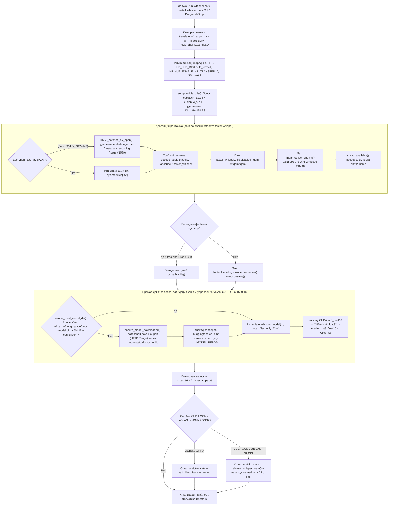

# Engine Blueprint: Архитектура транскрибатора Whisper v6 Argon

> **Документ:** Инженерная спецификация и внутреннее устройство `translate_v4_argon.py`, `Install Whisper.bat` и `Run Whisper.bat` (ревизия v6).  
> **Связанные документы:** [script-for-whisper-ai-argon-v6.md](https://www.google.com/search?q=./script-for-whisper-ai-argon-v6.md) | [changelog\_v4\_to\_v6.md](https://www.google.com/search?q=./changelog_v4_to_v6.md)

---

## 1. Общая схема пайплайна (v6)



---

## 2. Подсистема 0: Полиглот-оркестрация `.bat` и UTF-8 самораспаковка

В ревизии `v6` оба пакетных файла — `Install Whisper.bat` и `Run Whisper.bat` — являются самодостаточными контейнерами, содержащими полный исходный код `translate_v4_argon.py` после маркера `#---PYTHON_CODE_START---#`.

1. **Автообновление при каждом запуске (`Run Whisper.bat`):**
   * В `v5` распаковка `.py` происходила только при вызове `Install Whisper.bat`. В `v6` блок генерации встроен непосредственно в начало `Run Whisper.bat`.
   * Однострочник PowerShell читает сам `.bat` строго в кодировке `UTF-8` (`[IO.File]::ReadAllText($env:RUN_SELF, [Text.Encoding]::UTF8)`), находит последний маркер через `LastIndexOf` и атомарно перезаписывает `translate_v4_argon.py` в чистом `UTF-8 без BOM` (`New-Object System.Text.UTF8Encoding($false)`).
   * Это исключает повреждение кириллических литералов (двойную перекодировку `Windows-1251` -> `UTF-8`) и позволяет применять обновления скрипта без переустановки `pip`-пакетов.
2. **Дедупликация интерпретаторов и маршрутизация Python 3.14 / 3.15:**
   * `Install Whisper.bat` опрашивает `python`, `py -3.14`, `py -3.15` (либо целевую версию из аргумента `%1`, при отсутствии вызывая `py install <ver>` через [Python Install Manager 26.4](https://www.python.org/downloads/release/pymanager-264/)) и нормализует полный путь к `sys.executable` через список `SEEN_EXES`, исключая повторную установку в один и тот же интерпретатор.
   * `Run Whisper.bat` поддерживает явный выбор версии через флаги `--py <ver>`, `3.14` или `3.15`, а также прямую передачу до 9 медиафайлов через `Drag-and-Drop`.
3. **Защита потоков ввода-вывода:**
   * На уровне `.bat` и в шапке `translate_v4_argon.py` принудительно выставляются `PYTHONIOENCODING=utf-8`, `PYTHONUTF8=1`, `chcp 65001` и выполняется `sys.stdout.reconfigure(encoding="utf-8", errors="replace")` / `sys.stderr.reconfigure(...)`.

---

## 3. Подсистема 1: Динамическая инжекция CUDA 12 и cuDNN 9 (`setup_nvidia_dlls`)

На Windows пакет [CTranslate2](https://pypi.org/project/ctranslate2/) компилируется с динамической линковкой к библиотекам `cublas64_12.dll` (из пакета `nvidia-cublas-cu12`) и `cudnn64_9.dll` (из пакета `nvidia-cudnn-cu12`). При установке через `pip` эти DLL попадают в глубокие подкаталоги `site-packages/nvidia/cublas/bin` и `site-packages/nvidia/cudnn/bin`, отсутствующие в системном `PATH`.

Функция `setup_nvidia_dlls()` выполняется **до** `import ctranslate2`:
1. Собирает все каталоги из `sys.path`, `site.getsitepackages()` и `site.getusersitepackages()`.
2. Рекурсивно обходит подпапки `nvidia/` и `ctranslate2/`.
3. При обнаружении `cublas64_12.dll`, `cudnn64_9.dll` или подкаталога `bin`:
   * Добавляет директорию в начало `os.environ["PATH"]` (необходимо для поиска зависимых C++ библиотек на уровне процесса).
   * Регистрирует дескриптор через `os.add_dll_directory(root_dir)` и сохраняет его в глобальный список `_DLL_HANDLES` (в Python 3.8+ на Windows сборщик мусора закрывает DLL-директорию при удалении дескриптора).
4. Дополнительно проверяет системный `PATH` на случай установленного системного NVIDIA CUDA Toolkit 12.x и возвращает кортеж флагов `(has_cublas, has_cudnn)`.

---

## 4. Подсистема 2: Матрица совместимости Python 3.14 vs Python 3.15

Экосистема пакетов вокруг `faster-whisper 1.2.1` на Windows x64 (`win_amd64`) разделена в установщике на две ветки (`:BRANCH_314` и `:BRANCH_315`):

| Компонент | Python 3.14 (`cp314`) | Python 3.15 (`cp315`) | Особенности интеграции в движке v6 |
| :--- | :--- | :--- | :--- |
| **[CTranslate2 >= 4.8.5](https://pypi.org/project/ctranslate2/)** | `cp314-cp314-win_amd64.whl` | `cp315-cp315-win_amd64.whl` | Нативная поддержка CUDA 12 и квантования `int8_float16` / `int8_float32` / `int8` на обеих версиях Python. |
| **[PyAV (`av >= 19.0.2`)](https://pypi.org/project/av/)** | `cp312-abi3-win_amd64.whl` | `cp312-abi3-win_amd64.whl` | Stable ABI (`cp312-abi3`) со встроенными DLL FFmpeg. В версиях `>= 18.0` удалён аргумент `metadata_errors` из `av.open()` ([Issue #1589](https://github.com/SYSTRAN/faster-whisper/issues/1589)). |
| **[NumPy >= 2.5.4](https://pypi.org/project/numpy/)** | `cp314-cp314-win_amd64.whl` | `cp315-cp315-win_amd64.whl` | Полная бинарная совместимость. |
| **[tokenizers >= 0.23.3](https://pypi.org/project/tokenizers/)** | `cp310-abi3-win_amd64.whl` | `cp310-abi3-win_amd64.whl` | Rust-биндинги через `abi3` работают на 3.14 и 3.15 без пересборки. |
| **[onnxruntime >= 1.14,<2](https://pypi.org/project/onnxruntime/)** | `cp314-cp314-win_amd64.whl` | **Отсутствует** ([Issue #33271](https://github.com/microsoft/onnxruntime/issues/33271)) | Используется для Silero VAD (`vad_filter=True`). На 3.15 `faster-whisper` ставится с `--no-deps`, а `vad_filter` динамически отключается через `is_vad_available()`. |
| **`requests`, `tqdm`, `certifi`** | Устанавливаются явно в `:BRANCH_314` | Устанавливаются явно в `:BRANCH_315` | Обеспечивают потоковую докачку весов `ensure_model_downloaded()` с видимым прогресс-баром и актуальными корневыми SSL-сертификатами. |

---

## 5. Подсистема 3: Прямой менеджер загрузки моделей и обход зависаний `hf_xet` (`v6`)

В версии `v5` делегирование скачивания весов внутрь `WhisperModel("large-v3-turbo")` приводило к трем критическим проблемам на Windows:
* **Зависание `hf_xet` на 0 байт:** начиная с `huggingface_hub >= 0.30`, внутри `snapshot_download` по умолчанию активируется фоновый Rust-клиент `hf_xet`, который на Windows блокирует сетевой сокет на 0 байт ([разбор бага Xet](https://ai-muninn.com/en/blog/huggingface-download-stuck-zero-bytes-windows-ai-toolkit), [xet-core #850](https://github.com/huggingface/xet-core/issues/850)).
* **Скрытая шкала прогресса:** в [`faster_whisper/utils.py`](https://github.com/SYSTRAN/faster-whisper/blob/master/faster_whisper/utils.py) жёстко передаётся `tqdm_class=disabled_tqdm`, из-за чего скачивание 1.62 ГБ шло в полной тишине.
* **Нерабочий фоллбэк `HF_ENDPOINT`:** библиотека `huggingface_hub` считывает `os.environ["HF_ENDPOINT"]` один раз при импорте модуля. Попытка изменить `os.environ["HF_ENDPOINT"]` внутри блока `except` в `v5` игнорировалась.

В `v6` реализован собственный транспортный уровень загрузки моделей:

1. **Блокировка `hf_xet` и `hf_transfer`:**
   До импорта любых библиотек в `.bat` и `.py` выставляются:
   ```python
   os.environ["HF_HUB_DISABLE_XET"] = "1"
   os.environ["HF_HUB_ENABLE_HF_TRANSFER"] = "0"
   ```
   Также заглушка `faster_whisper.utils.disabled_tqdm` принудительно заменяется на `tqdm.tqdm`.
2. **Валидация целостности и поиск в системном кэше (`resolve_local_model_dir`):**
   * Проверяет локальные каталоги `./models/<model_name>` (включая алиасы `./models/turbo` и `./models/faster-whisper-large-v3-turbo`), а также стандартный кэш Hugging Face `~/.cache/huggingface/hub/models--<repo>/snapshots/*`.
   * Считает модель валидной **только** при одновременном наличии `config.json` и файла весов `model.bin` размером строго больше **50 МБ** (`os.path.getsize(bin_path) > 50_000_000`). Это предотвращает падение CTranslate2 на оборванных или пустых файлах.
3. **Потоковая докачка по HTTP `Range` (`ensure_model_downloaded` и `_download_single_file`):**
   * Если модель не найдена локально, скрипт поочерёдно опрашивает серверы `https://huggingface.co` (основной) и `https://hf-mirror.com` (резервное зеркало) по списку репозиториев `_MODEL_REPOS` (например, [mobiuslabsgmbh/faster-whisper-large-v3-turbo](https://huggingface.co/rtlingo/mobiuslabsgmbh-faster-whisper-large-v3-turbo/tree/main) и [deepdml/faster-whisper-large-v3-turbo-ct2](https://huggingface.co/deepdml/faster-whisper-large-v3-turbo-ct2)).
   * Каждый файл (`config.json`, `preprocessor_config.json`, `tokenizer.json`, `vocabulary.json`, `vocabulary.txt`, `model.bin`) качается во временный файл `<fname>.part` чанками по 1 МБ.
   * При обрыве связи и повторном запуске скрипт определяет размер существующего `.part`-файла и отправляет HTTP-заголовок `Range: bytes=<existing_size>-`, продолжая загрузку с места разрыва (код `206 Partial Content`) с отображением шкалы `tqdm` (МБ, проценты, скорость). Если пакет `requests` отсутствует, автоматически включается резервный загрузчик на базе стандартного `urllib.request`.
   * После завершения `os.replace(part_path, dest_path)` атомарно переименовывает файл, а `instantiate_whisper_model()` инициализирует `WhisperModel(local_dir, ..., local_files_only=True)`, полностью исключая сетевые вызовы внутри `faster-whisper`.

---

## 6. Подсистема 4: Гибридный аудио-декодер и тройной перехват `decode_audio`

### 6.1. Почему обычный monkey-patch `faster_whisper.audio.decode_audio` не работает
В исходном коде `faster_whisper/transcribe.py` на верхнем уровне модуля выполняется прямой импорт:
```python
from faster_whisper.audio import decode_audio
```
Когда скрипт импортирует `WhisperModel`, в пространстве имён `faster_whisper.transcribe` сохраняется прямая ссылка на оригинальную функцию `decode_audio`. Замена только `faster_whisper.audio.decode_audio` не влияет на вызовы внутри `WhisperModel.transcribe()`.

Поэтому в `translate_v4_argon.py` задействована трёхуровневая защита:
1. **Шим на уровне `av.open` (`_patched_av_open`):** проверяет `inspect.signature(av.open)` и удаляет устаревшие аргументы `metadata_errors` и `metadata_encoding` ([SYSTRAN/faster-whisper#1589](https://github.com/SYSTRAN/faster-whisper/issues/1589)) до передачи управления в Cython-ядро PyAV. Если пакет `av` отсутствует, в `sys.modules["av"]` инжектируется модуль-заглушка.
2. **Тройная привязка `_hybrid_decode_audio`:**
   ```python
   faster_whisper.audio.decode_audio = _hybrid_decode_audio
   faster_whisper.transcribe.decode_audio = _hybrid_decode_audio
   faster_whisper.decode_audio = _hybrid_decode_audio
   ```
3. **Аварийный декодер `decode_audio_ffmpeg`:** если `PyAV` не установлен или выбрасывает исключение на повреждённом медиаконтейнере, скрипт автоматически вызывает `ffmpeg.exe` (поиск в `./ffmpeg.exe`, `./bin/ffmpeg.exe`, `./ffmpeg/bin/ffmpeg.exe` и системном `PATH`):
   ```text
   ffmpeg -nostdin -threads 0 -i <input> -f s16le -ac <1|2> -acodec pcm_s16le -ar 16000 -
   ```
   Выходной PCM-поток преобразуется в `float32` массив в оперативной памяти без создания временных файлов на диске:
   ```python
   audio = np.frombuffer(proc.stdout, dtype=np.int16).astype(np.float32) / 32768.0
   ```

---

## 7. Подсистема 5: Линейный $O(N)$ алгоритм `collect_chunks`

В `faster-whisper 1.2.1` функция `faster_whisper.vad.collect_chunks` склеивает речевые сегменты, размеченные детектором голосовой активности Silero VAD. Поскольку `WhisperModel.transcribe()` вызывает `collect_chunks` с `max_duration=float("inf")`, все речевые фрагменты файла объединяются в единый массив.

* **Квадратичный алгоритм (`v1.2.1`):** на каждой итерации цикла выполнял `current_audio = np.concatenate((current_audio, audio[chunk["start"]:chunk["end"]]))`. На двухчасовой записи (1000–1500 чанков при `min_silence_duration_ms=500`) это порождало $\frac{N(N+1)}{2}$ полных копирований памяти (~350 ГБ трафика ОЗУ и 128 секунд зависания CPU перед стартом GPU, см. [SYSTRAN/faster-whisper#1690](https://github.com/SYSTRAN/faster-whisper/issues/1690)).
* **Линейный алгоритм (`_linear_collect_chunks`):** накапливает легковесные `numpy`-срезы `current_slices.append(audio[chunk["start"]:chunk["end"]])` в списке Python без копирования буфера и вызывает `np.concatenate(current_slices)` ровно один раз в конце блока. Функция подменяется одновременно в `faster_whisper.vad.collect_chunks` и `faster_whisper.transcribe.collect_chunks`, сокращая время склейки со **128 сек до 0.3 сек** при побайтово идентичном результате.

---

## 8. Подсистема 6: Управление памятью GPU (4 ГБ VRAM) и транзакционная запись

Видеокарта **NVIDIA GeForce GTX 1650 Ti** (архитектура Turing, Compute Capability 7.5) оснащена 4096 МБ видеопамяти, из которых 500–800 МБ удерживаются Windows DWM и фоновыми приложениями.

1. **Квантование `int8_float16`:** веса модели `large-v3-turbo` (809 млн параметров, 4 декодер-слоя вместо 32 у `large-v3`) в формате `int8_float16` занимают ~1.55 ГБ VRAM, оставляя безопасный резерв под KV-кэш и буферы cuBLAS.
2. **Параметры декодирования:** жёстко заданы `beam_size=1`, `best_of=1`, `condition_on_previous_text=False`, что предотвращает размножение лучей поиска в видеопамяти и устраняет галлюцинации зацикливания на шумных участках.
3. **Каскад инициализации (`load_whisper_model`):**
   * Попытка 1: `large-v3-turbo` (`CUDA`, `int8_float16`)
   * Попытка 2: `large-v3-turbo` (`CUDA`, `int8_float32` — обход возможных FP16-сбоев отдельных версий cuDNN на архитектуре Turing)
   * Попытка 3: `medium` (`CUDA`, `int8_float16`)
   * Попытка 4: `large-v3-turbo` (`CPU`, `int8`, 4 потока)
4. **Транзакционный откат при сбоях во время расшифровки (`transcribe_file_with_fallback`):**
   * Перед началом обработки каждого файла фиксируются смещения открытых дескрипторов: `txt_pos = f_txt.tell()` и `timed_pos = f_timed.tell()`.
   * **Сбой `onnxruntime`:** если во время выполнения Silero VAD выбрасывает `RuntimeError`, связанный с `onnxruntime`, скрипт откатывает файловые потоки через `seek(txt_pos)` / `truncate()`, отключает `vad_filter=False` и прозрачно перезапускает расшифровку текущего файла.
   * **Сбой GPU (`CUDA out of memory`, `cublas`, `cudnn`):** если нехватка VRAM возникает посреди тяжёлого файла, скрипт откатывает частичную запись текущего файла через `seek` + `truncate` (сохраняя нетронутыми все предыдущие файлы пакета), принудительно освобождает видеопамять CTranslate2 через `release_whisper_vram(model)` (`del model.model` + `gc.collect()`) и перезапускает файл на резервной модели `medium` (`CUDA int8_float16`) либо на процессоре (`CPU int8`).
