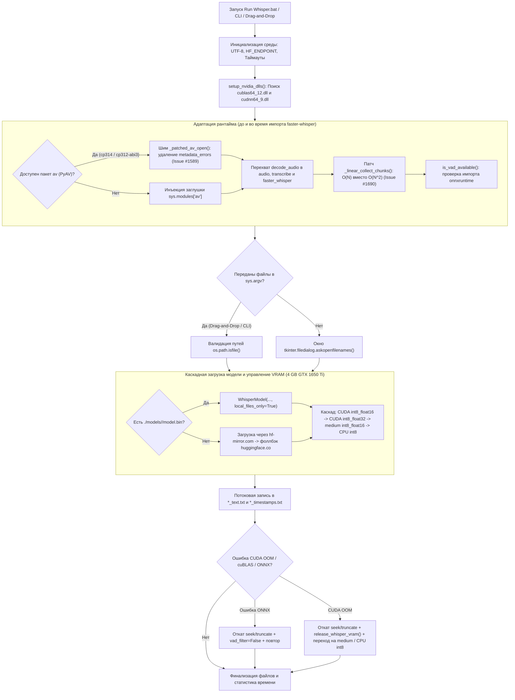

# Engine Blueprint: Архитектура транскрибатора Whisper v4 Argon

> **Документ:** Инженерная спецификация и внутреннее устройство `translate_v4_argon.py` и батч-оркестраторов.  
> **Связанный отчёт:** [`Scripts for Whisper v4 argon.md`](./Scripts%20for%20Whisper%20v4%20argon.md)

---

## 1. Общая схема пайплайна



---

## 2. Подсистема 1: Динамическая инжекция CUDA 12 и cuDNN 9 (`setup_nvidia_dlls`)

На Windows пакет `ctranslate2` компилируется с динамической линковкой к библиотекам `cublas64_12.dll` (из пакета `nvidia-cublas-cu12`) и `cudnn64_9.dll` (из пакета `nvidia-cudnn-cu12`). При установке этих пакетов через `pip` DLL-файлы попадают в глубокие подкаталоги `site-packages/nvidia/cublas/bin` и `site-packages/nvidia/cudnn/bin`, которые не добавляются в системный `PATH` автоматически.

Функция `setup_nvidia_dlls()` выполняется **до** `import ctranslate2`:
1. Собирает все каталоги из `sys.path`, `site.getsitepackages()` и `site.getusersitepackages()`.
2. Рекурсивно обходит подпапки `nvidia/` и `ctranslate2/`.
3. При обнаружении `cublas64_12.dll`, `cudnn64_9.dll` или каталога `bin`:
   * Добавляет директорию в начало `os.environ["PATH"]` (необходимо для поиска зависимых библиотек C++ на уровне процесса).
   * Регистрирует дескриптор через `os.add_dll_directory(root_dir)` и сохраняет его в глобальный список `_DLL_HANDLES` (в Python 3.8+ на Windows сборщик мусора закрывает DLL-директорию, если дескриптор удалён из памяти).
4. Дополнительно сканирует системный `PATH` на случай, если у пользователя установлен системный NVIDIA CUDA Toolkit 12.x.

---

## 3. Подсистема 2: Матрица совместимости Python 3.14 vs Python 3.15

По состоянию на ноябрь 2026 года экосистема пакетов вокруг `faster-whisper 1.2.1` имеет следующие бинарные колёса под Windows x64 (`win_amd64`):

| Компонент | Python 3.14 (`cp314`) | Python 3.15 (`cp315`) | Особенности интеграции в движке |
| :--- | :--- | :--- | :--- |
| **[CTranslate2 4.8.5](https://pypi.org/project/ctranslate2/)** | `cp314-cp314-win_amd64.whl` | `cp315-cp315-win_amd64.whl` | Полная нативная поддержка CUDA 12 и INT8/FP16 квантования на обеих версиях Python. |
| **[PyAV (`av 19.0.2`)](https://pypi.org/project/av/)** | `cp312-abi3-win_amd64.whl` | `cp312-abi3-win_amd64.whl` | Колесо собрано под Stable ABI (`cp312-abi3`) со встроенными DLL FFmpeg. В версиях `>= 18.0` удалён аргумент `metadata_errors` из `av.open()` ([Issue #1589](https://github.com/SYSTRAN/faster-whisper/issues/1589)). |
| **[NumPy 2.5.4](https://pypi.org/project/numpy/)** | `cp314-cp314-win_amd64.whl` | `cp315-cp315-win_amd64.whl` | Полная бинарная совместимость. |
| **[tokenizers 0.23.3](https://pypi.org/project/tokenizers/)** | `cp310-abi3-win_amd64.whl` | `cp310-abi3-win_amd64.whl` | Rust-биндинги через `abi3` работают на 3.14 и 3.15 без пересборки. |
| **[onnxruntime 1.31.1](https://pypi.org/project/onnxruntime/)** | `cp314-cp314-win_amd64.whl` | **Отсутствует** ([Issue #33271](https://github.com/microsoft/onnxruntime/issues/33271)) | Используется только для фильтрации пауз Silero VAD (`vad_filter=True`). На 3.15 `faster-whisper` ставится с `--no-deps`, а `vad_filter` динамически выключается при отсутствии `onnxruntime`. |

---

## 4. Подсистема 3: Гибридный аудио-декодер и тройной перехват `decode_audio`

### 4.1. Почему обычный monkey-patch `faster_whisper.audio.decode_audio` не работает
В исходном коде `faster_whisper/transcribe.py` на верхнем уровне модуля написано:
```python
from faster_whisper.audio import decode_audio
```
Когда пользовательский скрипт выполняет `from faster_whisper import WhisperModel`, интерпретатор Python загружает `faster_whisper/transcribe.py` и создаёт локальную ссылку `faster_whisper.transcribe.decode_audio`, указывающую на оригинальную функцию. Если после этого заменить только `faster_whisper.audio.decode_audio = custom_fn`, метод `WhisperModel.transcribe()` продолжит вызывать старую функцию из пространства имён `faster_whisper.transcribe`.

Поэтому в `translate_v4_argon.py` применяется:
1. **Шим на уровне `av.open` (`_patched_av_open`)**: перехватывает вызов внутри самого `PyAV`, проверяя `inspect.signature(av.open)` и удаляя `metadata_errors` / `metadata_encoding` до передачи в Cython-расширение `av.container.core.open`.
2. **Тройная привязка `_hybrid_decode_audio`**:
   ```python
   faster_whisper.audio.decode_audio = _hybrid_decode_audio
   faster_whisper.transcribe.decode_audio = _hybrid_decode_audio
   faster_whisper.decode_audio = _hybrid_decode_audio
   ```
3. **Аварийный декодер `decode_audio_ffmpeg`**: если `av` не установлен или повреждён контейнер, вызывается `ffmpeg.exe` (поиск в `./ffmpeg.exe`, `./bin/ffmpeg.exe`, `./ffmpeg/bin/ffmpeg.exe` и системном `PATH`):
   ```text
   ffmpeg -nostdin -threads 0 -i <input> -f s16le -ac <1|2> -acodec pcm_s16le -ar 16000 -
   ```
   Выходной PCM-поток преобразуется без промежуточных файлов на диске:
   ```python
   audio = np.frombuffer(proc.stdout, dtype=np.int16).astype(np.float32) / 32768.0
   ```

---

## 5. Подсистема 4: Линейный $O(N)$ алгоритм `collect_chunks`

В `faster-whisper 1.2.1` функция `faster_whisper.vad.collect_chunks` склеивает речевые сегменты, найденные Silero VAD. Из-за того, что `WhisperModel.transcribe()` вызывает `collect_chunks` с `max_duration=float("inf")`, все речевые фрагменты файла попадают в один список.

* **Старый алгоритм (`v1.2.1`):** на каждой итерации цикла выполнял `current_audio = np.concatenate((current_audio, audio[chunk["start"]:chunk["end"]]))`. На полутора-двухчасовой записи (1000–1500 чанков при `min_silence_duration_ms=500`) это порождало $\frac{N(N+1)}{2}$ копирований памяти (~350 ГБ трафика ОЗУ и 128 секунд простоя CPU до начала работы GPU, см. [SYSTRAN/faster-whisper#1690](https://github.com/SYSTRAN/faster-whisper/issues/1690)).
* **Новый алгоритм (`_linear_collect_chunks`):** накапливает view-срезы `current_slices.append(audio[chunk["start"]:chunk["end"]])` в стандартном списке Python (без копирования буфера) и выполняет единичный `np.concatenate(current_slices)` в конце группы. Время выполнения на 2.5-часовом файле снижено со **128 сек до 0.3 сек** при побайтово идентичном результате.

---

## 6. Подсистема 5: Управление памятью GPU (4 ГБ VRAM) и транзакционная запись

Видеокарта **NVIDIA GeForce GTX 1650 Ti** (архитектура Turing, Compute Capability 7.5) имеет 4096 МБ видеопамяти, из которых 500–800 МБ заняты Windows DWM и браузерами.

1. **Квантование `int8_float16`:** веса модели `large-v3-turbo` (809 млн параметров, 4 декодер-слоя вместо 32 у `large-v3`) в формате `int8_float16` занимают ~1.55 ГБ VRAM, оставляя безопасный запас под KV-кэш и буферы cuBLAS.
2. **Параметры декодирования:** используются `beam_size=1`, `best_of=1`, `condition_on_previous_text=False`, что отключает размножение лучей поиска в VRAM и предотвращает зацикливание (галлюцинации повторов) на шумных участках.
3. **Каскад загрузки (`load_whisper_model`):**
   * Попытка 1: `large-v3-turbo` (`CUDA`, `int8_float16`)
   * Попытка 2: `large-v3-turbo` (`CUDA`, `int8_float32` — обход возможных FP16-сбоев отдельных версий cuDNN на Turing)
   * Попытка 3: `medium` (`CUDA`, `int8_float16`)
   * Попытка 4: `large-v3-turbo` (`CPU`, `int8`, 4 потока)
4. **Транзакционный откат при OOM (`transcribe_file_with_fallback`):**
   * Перед началом расшифровки каждого файла фиксируются позиции файловых дескрипторов: `txt_pos = f_txt.tell()` и `timed_pos = f_timed.tell()`.
   * Если в середине расшифровки возникает `RuntimeError` (`CUDA out of memory`, `cublas`, `cudnn`), скрипт выполняет `f_txt.seek(txt_pos)` + `f_txt.truncate()`, полностью стирая недописанный кусок текущего файла (не затрагивая предыдущие успешно расшифрованные файлы в пакете).
   * Функция `release_whisper_vram(model)` принудительно удаляет C++ объект `del model.model` и вызывает `gc.collect()`, мгновенно освобождая видеопамять CTranslate2 до загрузки резервной модели `medium` или перехода на `CPU int8`.
