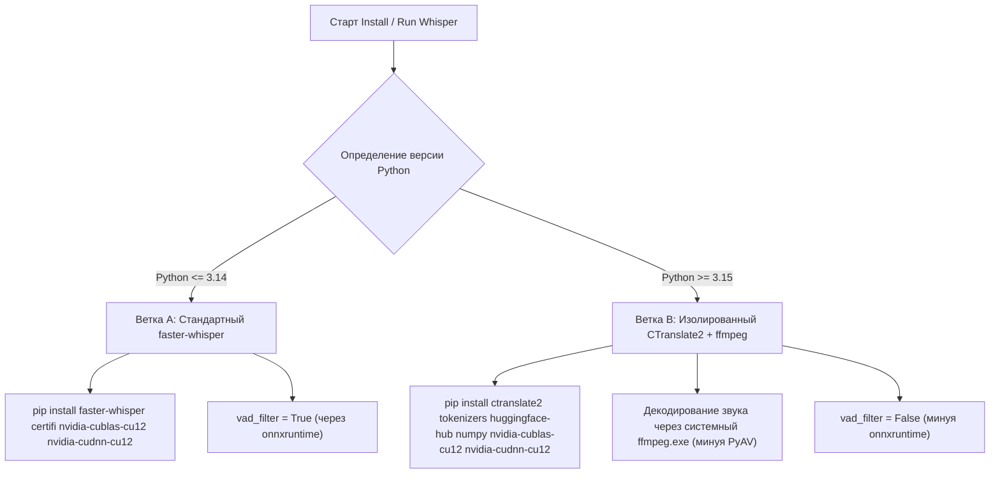

# Технический отчет: Модернизация Whisper AI (Ноябрь 2026)

> **Назначение:** Документ предназначен для передачи другой нейросети или разработчику для рефакторинга файлов в каталоге `SupportedProjects/Script for Whisper AI/`.

---

## 1. Стек и целевое окружение
* **ОС:** Windows 10/11 x64
* **GPU:** NVIDIA GeForce GTX 1650 Ti (4096 MB VRAM, драйвер 610.47, CUDA 12.x / 13.x)
* **Интерпретаторы:** 
  * Стабильный: **Python 3.14.x** (дефолтная ветка)
  * Экспериментальный: **Python 3.15.x** (выпущен в октябре 2026)
* **Менеджер Python:** Python Install Manager 26.4 (`py install`, `py uninstall`, `py list`)

---

## 2. Проблема №1: Кракозябры в Windows Console

### Причина сбоя
1. В файле `translate_v4_argon.py` кириллические строки сохранены с двойным перекодированием (UTF-8 байты были интерпретированы в кодировке Windows-1251 и повторно сохранены в UTF-8, например `Выберите`).
2. В `Install Whisper.bat` и `Run Whisper.bat` выставлен `chcp 65001 >nul`, однако сам Python в Windows перехватывает стандартный вывод через OEM/ANSI кодировку терминала, если не форсирован UTF-8 на уровне среды.

### Требуемые исправления
1. **В `.bat` файлах** перед вызовом Python принудительно задать переменные среды:
   ```cmd
   set PYTHONIOENCODING=utf-8
   set PYTHONUTF8=1
   chcp 65001 >nul
   ```
2. **В начале `translate_v4_argon.py`** добавить реконфигурацию потоков:
   ```python
   import sys
   if hasattr(sys.stdout, "reconfigure"):
       sys.stdout.reconfigure(encoding="utf-8", errors="replace")
       sys.stderr.reconfigure(encoding="utf-8", errors="replace")
   ```
3. **Восстановить текст в исходнике**: декодировать поврежденные строки `CP1251 -> UTF-8` и сохранить файл в чистом `UTF-8 without BOM`.

---

## 3. Проблема №2: Запуск на Python 3.15 vs Python <= 3.14



### Узкие места Python 3.15 в экосистеме ML (состояние на ноябрь 2026)
1. **`onnxruntime`**: Microsoft не публикует официальные колеса `cp315` на PyPI ([Issue #33271](https://github.com/microsoft/onnxruntime/issues/33271)). Попытка поставить `faster-whisper` штатным `pip install` вызывает бесконечный откат версий назад.
2. **`av` (PyAV)**:
   * Старый `av < 13` (который прописан в старых faster-whisper) не компилируется современным Cython 3 (`Cannot assign type ... to noexcept nogil`).
   * Свежий `av 19.x` имеет бинарник под 3.15, но в нем удален параметр `metadata_errors="ignore"`. Из-за этого вызов `decode_audio` в `faster_whisper/audio.py` падает с `TypeError`.
3. **`PyYAML`**: Требует флаг `$env:PYYAML_FORCE_LIBYAML="0"` для чистой сборки без C++ компилятора MSVC.
4. **`CTranslate2`**: **Полностью готов под 3.15.** Начиная с версии `4.8.5` ([PR #2129](https://github.com/OpenNMT/CTranslate2/pull/2129)), CTranslate2 официально собирает колеса `cp315-win_amd64` с поддержкой CUDA 12.

---

## 4. Проблема №3: Зависание загрузки весов с Hugging Face Hub (0% сети)

### Причина сбоя
1. При первой инициализации `WhisperModel("large-v3-turbo")` библиотека `huggingface_hub` запрашивает файлы через CloudFront/AWS S3 CDN (`cdn-lfs.huggingface.co`).
2. В РФ эти CDN-хосты подвергаются глушению и сбросу TLS-сессий.
3. Мелкие файлы метаданных (`config.json`, `tokenizer.json` по 1 МБ) успевают скачаться, но на основном файле весов `model.bin` (~1.6 ГБ) TCP-соединение переходит в состояние `Established`, сокет внутри `requests`/`urllib3` блокируется без таймаута, и процесс замирает с 0% сети и 0 байт в `.incomplete`.

### Требуемые исправления
1. **В `.bat` файлах добавить маршрутизацию через официальное скоростное зеркало:**
   ```cmd
   set HF_ENDPOINT=https://hf-mirror.com
   ```
2. **В `translate_v4_argon.py` предусмотреть работу с локальной папкой модели:**
   Перед сетевым скачиванием проверять наличие локального каталога моделей (например, `models/large-v3-turbo` или `models/turbo`):
   ```python
   local_model_path = os.path.join(os.path.dirname(__file__), "models", model_name)
   if os.path.isdir(local_model_path) and os.path.isfile(os.path.join(local_model_path, "model.bin")):
       model = WhisperModel(local_model_path, device="cuda", compute_type="int8_float16", local_files_only=True)
   else:
       os.environ.setdefault("HF_ENDPOINT", "https://hf-mirror.com")
       model = WhisperModel(model_name, device="cuda", compute_type="int8_float16")
   ```
3. Это дает пользователю возможность скачать модель один раз через браузер (с зеркала или торрента) и запускать расшифровку полностью оффлайн без риска сетевого зависания.

---

## 5. Архитектурный план доработки батников и скрипта

### Шаг 1. Детект версии и настройка среды в `.bat` файлах
```cmd
set PYTHONIOENCODING=utf-8
set PYTHONUTF8=1
set HF_ENDPOINT=https://hf-mirror.com
chcp 65001 >nul

for /f "tokens=1,2 delims=." %%a in ('python -c "import sys; print(f'{sys.version_info.major}.{sys.version_info.minor}')"') do (
    set PY_MAJ=%%a
    set PY_MIN=%%b
)
```

### Шаг 2. Разделение установки зависимостей (`Install Whisper.bat`)
* **Если `PY_MIN LEQ 14`**:
  ```cmd
  python -m pip install faster-whisper certifi nvidia-cublas-cu12 nvidia-cudnn-cu12 --no-cache-dir
  ```
* **Если `PY_MIN GEQ 15`**:
  ```cmd
  set PYYAML_FORCE_LIBYAML=0
  python -m pip install ctranslate2 numpy tokenizers huggingface-hub certifi nvidia-cublas-cu12 nvidia-cudnn-cu12 --no-cache-dir
  python -m pip install --no-deps faster-whisper
  ```

### Шаг 3. Адаптация логики транскрипции (`translate_v4_argon.py`)
1. **Декодирование аудио без PyAV под 3.15**:
   Если `sys.version_info >= (3, 15)`, переопределить декодирование звука в `faster_whisper.audio.decode_audio` на прямой вызов системного `ffmpeg.exe`:
   * Вызов: `ffmpeg -i <input> -f s16le -ac 1 -ar 16000 pipe:1`.
   * Преобразование: `np.frombuffer(out, np.int16).flatten().astype(np.float32) / 32768.0`.
   * Полностью устраняет зависимость от пакета `av`.
2. **Отключение VAD под 3.15**:
   При `sys.version_info >= (3, 15)` форсировать `vad_filter = False`, чтобы исключить обращение к отсутствующему `onnxruntime`.
3. **Оффлайн-приоритет моделей**:
   Поддержка пути `./models/<model_name>` и зеркала `https://hf-mirror.com`.

---

## 6. Ссылки на официальные репозитории для сверки
* **CTranslate2 (OpenNMT):** [github.com/OpenNMT/CTranslate2](https://github.com/OpenNMT/CTranslate2) (релиз 4.8.5 с поддержкой Python 3.15).
* **faster-whisper (SYSTRAN):** [github.com/SYSTRAN/faster-whisper](https://github.com/SYSTRAN/faster-whisper).
* **ONNX Runtime (Microsoft):** [github.com/microsoft/onnxruntime](https://github.com/microsoft/onnxruntime) (трекинг сборок под Python 3.15, Issue #33271).
* **WhisperS2T-Reborn:** [pypi.org/project/whisper-s2t-reborn](https://pypi.org/project/whisper-s2t-reborn/) (пайплайн 2026 года на CTranslate2 с нативной поддержкой FFmpeg без PyAV).
* **Hugging Face Mirror:** [hf-mirror.com](https://hf-mirror.com) (зеркало для загрузки весов в обход сетевых блокировок).
